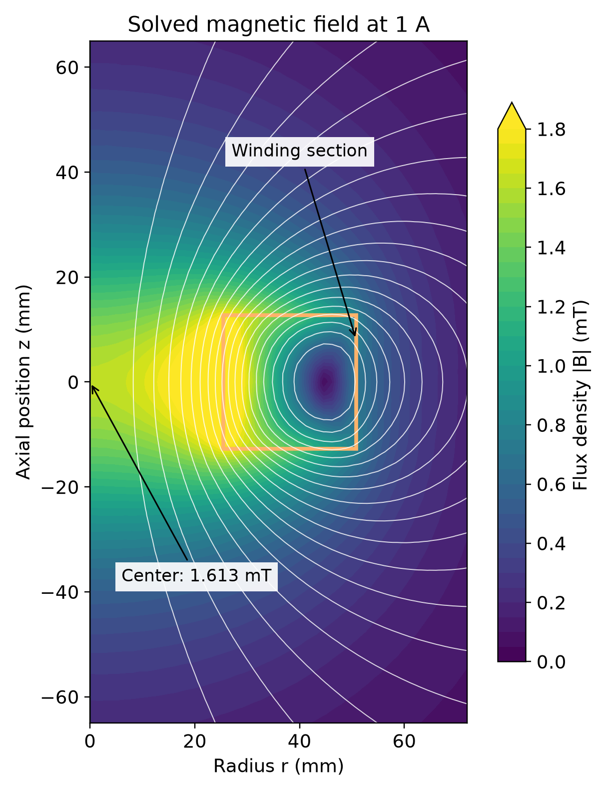
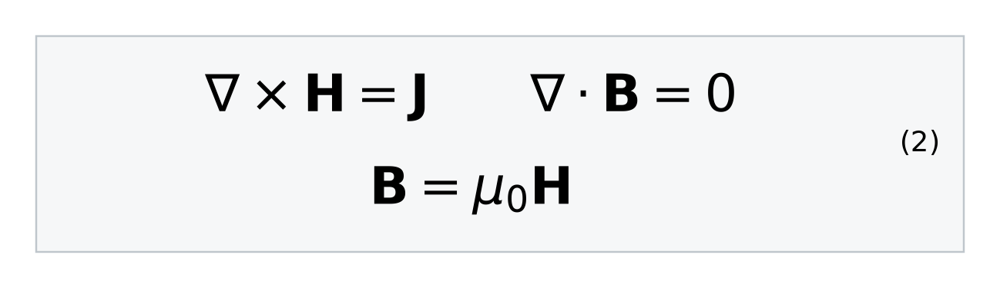
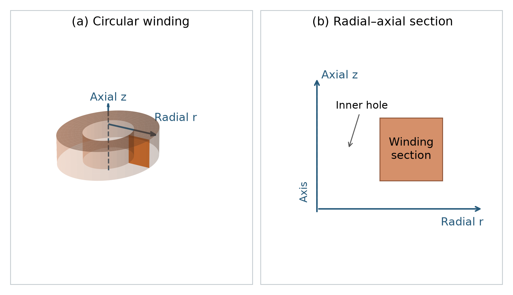
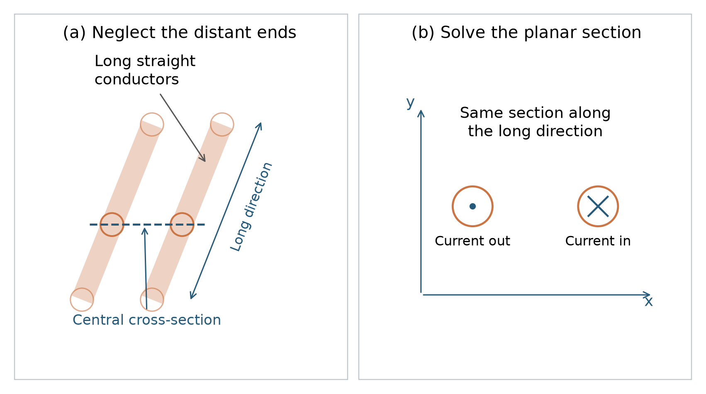
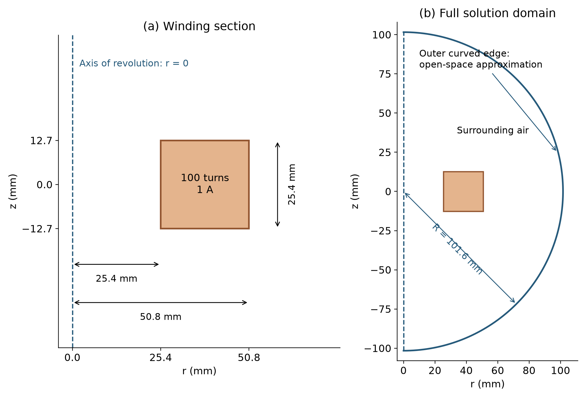
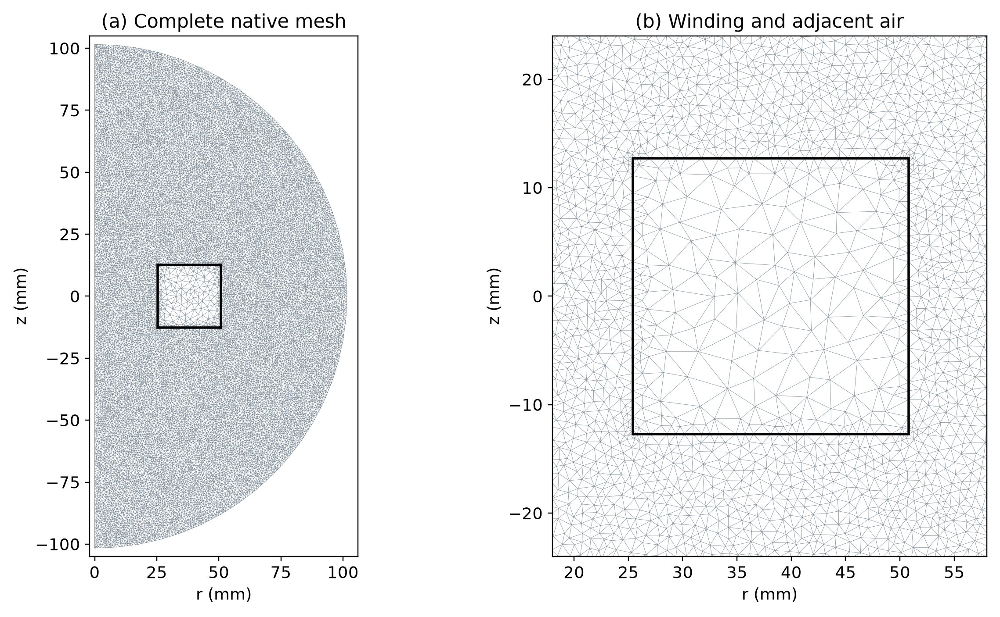
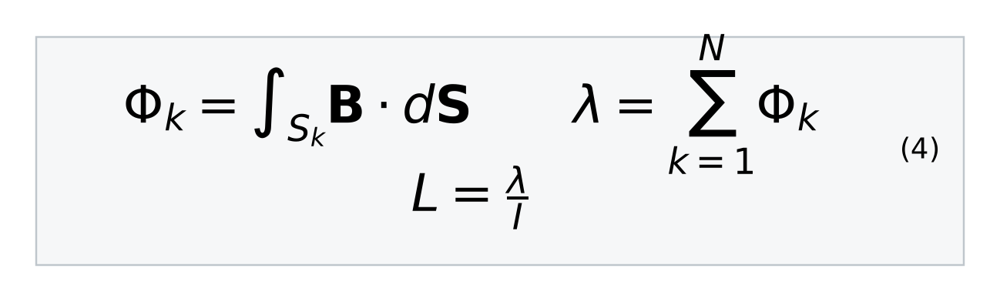
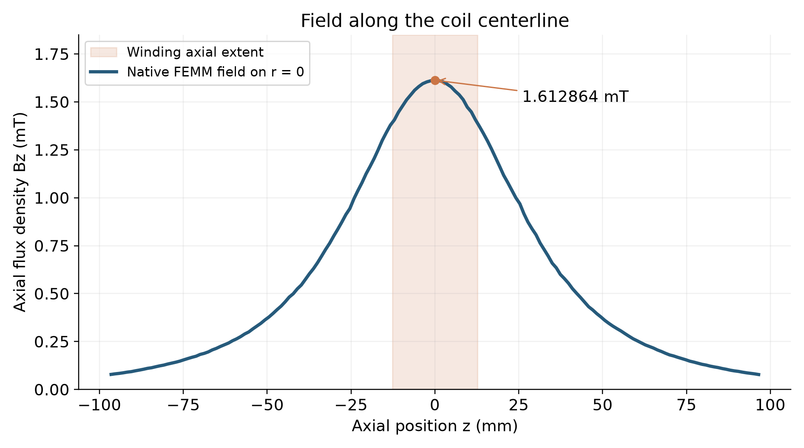

# Part 1: A First Electromagnetic Model in FEMM

*Build an air-core coil, understand the field equations, and calculate its inductance.*

I’m building a workflow for using AI to model and test electromagnetic devices. In this first article, we’ll do the simulation ourselves: describe a coil, tell a field solver how it is energized, and calculate its magnetic field and inductance. Later, we’ll automate these steps. First, we need to understand the electromagnetic problem we are giving the software.

We’ll use FEMM, short for Finite Element Method Magnetics. It is an open-source program for solving field problems, including the low-frequency magnetic problems found in coils, actuators and electrical machines. Its [documentation](https://www.femm.info/doku/doku.php?id=Documentation) includes both the user manual and worked examples. Our example is deliberately small enough to draw and explain in full.

Figure 1 shows the field we’ll calculate. The rectangle is a section through the winding. Color shows magnetic flux density, while the curves follow the magnetic field. The field occupies the hole through the coil, the winding itself and the surrounding air. Understanding why those regions appear in the model is the first part of learning to use FEMM.



*Figure 1. Magnetic field of the 100-turn coil carrying 1 A. This is the solved radial–axial section, plotted from native FEMM results. The outlined rectangle is the winding; the vertical line marks the coil axis. Only part of the surrounding air is shown here.*

## Start with a coil we can draw

Imagine winding insulated wire around a cylindrical former, then removing the former. The result is a coil with an empty central hole: an air-core coil. Current flows around the hole, and the magnetic fields produced by the turns add together. We want to calculate how this particular arrangement links magnetic flux to its winding, which will give us its inductance.

We’ll use a documented case from FEMM’s [AirCore example](https://www.femm.info/doku/doku.php?id=AirCore). The winding has 100 turns, an inner radius of 25.4 mm, an outer radius of 50.8 mm and an axial length of 25.4 mm. Each turn carries 1 A. These dimensions describe the entire winding pack, rather than the diameter of one wire. Figure 4 will show exactly where they enter the model.

You may already know the long-solenoid approximation in Equation (1). Here N is the number of turns, S is the coil’s internal cross-sectional area and ℓ is its length. The expression assumes a long, slender coil with a nearly uniform internal field and small end effects.


*Equation (1). The familiar inductance approximation for a long air-core solenoid. The permeability of free space is μ₀. This relation is a useful starting point, but its geometric assumptions do not fit our short, thick winding.*

Our coil is shorter than its outer radius and has a substantial radial thickness. Its field spreads around the ends, as Figure 1 shows. The nearly uniform field assumed by the long-solenoid expression is therefore a poor description of this geometry. We need a calculation that accounts for where the field actually goes.

There are better coil formulas, including empirical fits, and an air-core winding can also be analyzed by numerically integrating the fields of current loops. We use finite elements because the same modeling process extends to shapes and materials that are harder to handle analytically. Before moving to an iron core or a motor, this coil lets us learn the process without also having to understand magnetic saturation or a complicated winding layout.

## What FEMM is solving

We hold the current constant and calculate the resulting steady magnetic field. This is a magnetostatic problem. Physically, it corresponds to examining the coil after the electrical transient has settled, with the current maintained at 1 A. We are not calculating how the current rises after connecting a battery.

The relevant Maxwell equations are shown in Equation (2). Ampère’s law relates the circulation of magnetic field intensity H to current density J. Gauss’s law for magnetism says that magnetic flux has no isolated sources or sinks. A magnetic field line continues through space rather than ending at the edge of the winding.



*Equation (2). The steady-current magnetic equations. B is magnetic flux density, H is magnetic field intensity, J is current density, and μ₀ is the permeability of free space. Air and the nonmagnetic winding use relative permeability one in this model.*

The symbols describe quantities with different roles. J tells us where current flows. H describes the magnetic excitation, and the material law relates it to B. B is measured in tesla and is the quantity shown by the color scale in Figure 1. In iron, the relation between B and H can be nonlinear. For our air-core model, it is linear, which makes the first calculation easier to interpret.

FEMM solves the magnetic problem using a potential formulation. It represents the field through a magnetic vector potential A, with B obtained from its spatial variation, as in Equation (3). In an axisymmetric problem, the corresponding flux function is used. You do not have to derive that formulation to build this coil, but it explains what the numerical method is approximating: a spatial field, from which quantities such as inductance are calculated.


*Equation (3). The magnetic field is obtained from the curl of the vector potential. This representation also satisfies the no-magnetic-monopoles condition in Equation (2).*

To turn these equations into a model, we need to define the winding section, assign material laws to the winding and air, supply the winding current, and describe how the field behaves at the outer edge of the surrounding air. The first decision is which section of the three-dimensional coil we can use.

## How a three-dimensional coil becomes a two-dimensional model

Walk around the axis of an ideal circular winding. Its inner radius, outer radius and length do not change with angle. Current follows the same circular direction all the way around. This rotational symmetry allows us to describe the device using a radial–axial section. The problem is axisymmetric.

The two coordinate directions have specific physical meanings. Radial distance r is measured outward from the coil’s central axis. Axial position z is measured along that axis. Figure 2(a) marks both directions on the circular winding. Figure 2(b) uses those same directions for the section we draw in FEMM.



*Figure 2. (a) A circular winding with the radial and axial directions marked; the highlighted rectangle is a cut through its winding pack. (b) That rectangle in the radial–axial plane. Radial distance increases to the right, axial position increases upward, and the dashed line is the coil axis. Revolving the rectangle through a full turn produces the winding in panel (a). The sketches explain the geometry; the dimensions are given in Figure 4.*

A rectangle in Figure 2(b) represents a ring-shaped winding pack because FEMM revolves the section around the axis. It does not represent a flat block of copper. The empty region between the axis and the rectangle becomes the hole through the coil. We draw only the positive-radius half of the section; revolving it already accounts for the complete device.

The field solution has the same symmetry. At a given radius and axial position, it is the same around the circumference. FEMM can therefore calculate the winding’s three-dimensional magnetic behavior from this two-dimensional description, within the distributed-winding approximation we are using.

## Why a planar section represents a different device

Now consider two long, straight, parallel conductors. Near the middle, far from their ends, a cross-section changes very little as we move along the wires. A planar model uses that translational assumption: the section extends uniformly along a straight direction. It does not rotate around an axis.

Figure 3(a) marks a central cross-section of the two conductors. Figure 3(b) shows the corresponding plane. A dot indicates current coming out of the page, like the tip of an arrow; a cross indicates current going into the page, like its tail. These symbols identify the direction of current perpendicular to the section.



*Figure 3. (a) A section through the central region of long, parallel conductors. The planar approximation neglects the distant wire ends. (b) The section solved in the x–y plane, with the current direction marked for each conductor. Extending this section straight along the conductors produces the approximation in panel (a). These are explanatory sketches, not additional FEMM calculations.*

The distinction is now physical rather than just a software setting. The rectangle in our coil model must revolve to make a circular winding. Treating it as a planar region would extend it straight instead and give a different current path. Selecting “planar” for the coil would ask FEMM to solve a different device.

Rotating machines can offer a further reduction when both their geometry and excitation repeat from sector to sector. Matching conditions on the sector edges must preserve that repetition, including a possible sign change in the excitation. We will return to rotating machines later in the series. For the present coil, the relevant choice is axisymmetry.

## Define the winding section and its excitation

For our coil, the axisymmetric model is appropriate once we replace the individual turns with a distributed winding region. Figure 4 shows the section we actually draw. The horizontal coordinate is radial distance, not diameter. The winding begins 25.4 mm from the axis and ends 50.8 mm from it. Its axial extent runs from −12.7 mm to +12.7 mm, with the midpoint at zero.



*Figure 4. (a) The dimensioned winding section. Revolving it around the dashed zero-radius axis produces the circular coil in Figure 2(a). (b) The complete solution domain: the same winding inside a semicircle of surrounding air. After revolution, that semicircle represents a sphere of radius 101.6 mm. The curved edge receives the open-boundary approximation.*

Why not draw 100 individual wires? Here we want the bulk magnetic field and winding inductance. We assign 100 turns to the rectangle and distribute their excitation over its area. The current density is therefore an average over the winding pack. The model does not calculate the fine field variation between neighboring wires or the detailed current density inside each strand. Those details are unnecessary for this first bulk-field calculation.

Both the winding region and the surrounding air have relative permeability one. They differ because the winding carries the imposed current. Assigning the turn count and current to that region is what makes it a source of magnetic field; merely drawing a copper-colored rectangle would not energize anything.

## The surrounding air and the mesh are part of the model

The field does not stop at the surface of the coil. If we modeled only the winding rectangle, we would leave out the air through which much of its field passes. We therefore surround it with the larger region in Figure 4(b).

Real open space extends indefinitely, while our finite-element mesh has to end somewhere. This example places its outer edge 101.6 mm from the origin and uses the AirCore example’s asymptotic boundary condition. It approximates how the field continues and decays outside the drawn region. That boundary is a numerical representation of distant space, not a physical shield around the coil.

The position and type of boundary can affect the answer. Moving it too close or applying an unsuitable condition can distort the field we calculate. This is a separate modeling choice from the winding dimensions. We keep the documented boundary treatment here so that our calculation has a clear reference for comparison.

Inside the domain, FEMM divides the section into triangles: the finite-element mesh. Figure 5 shows the actual mesh used in this run. The triangle edges are numerical subdivisions, not additional wires or material interfaces.



*Figure 5. The native mesh used for the baseline solve: 35,388 triangular elements. Figure 5(b) enlarges the winding and nearby air shown in Figure 5(a). The black rectangle marks the winding boundary; all other thin edges shown are mesh edges.*

The numerical approximation represents the potential using values associated with the mesh and simple functions within each element. Combining the element equations produces a system of equations for the whole domain. Solving that system gives the potential distribution, from which FEMM obtains B and the winding properties. Increasing the number of triangles gives the approximation more spatial resolution, at a cost in computation and memory.

This is why a smooth color plot is not, by itself, an accuracy check. Plotting software can display an attractive image from a relatively coarse field solution. To investigate discretization error, we solve the same physical model with a finer mesh and compare a quantity of interest. For this article, that quantity will be inductance. We’ll return to the numerical comparison after extracting it.

## From the magnetic field to inductance

Before running the script, it helps to separate three quantities that are easy to confuse: flux density B, magnetic flux Φ and winding flux linkage λ.

B describes the field at a location. Magnetic flux is obtained by integrating the normal component of B over a surface bounded by a wire turn. If the field were uniform and perpendicular to that surface, the flux would simply be B times its area. In this coil it is not uniform, so the spatial integral matters.

Flux linkage adds the flux linked by all the turns. If every turn linked the same flux, linkage would be the turn count multiplied by that flux. In a winding with finite thickness and length, different turns can link different fluxes, so the more general expression is a sum over turns. Equation (4) puts those relationships together.



*Equation (4). Φₖ is the flux through a surface bounded by turn k. Winding flux linkage λ sums the contributions of the turns. For this linear air-core winding, with one independent current and no permanent-magnet bias, inductance is the linkage-to-current ratio shown in the final line.*

For a simple numerical illustration, suppose each of 100 turns links 10 μWb. The linkage is then 1,000 μWb-turn, or 0.001 Wb-turn. At 1 A that would correspond to 0.001 H, or 1 mH. This illustration explains the units; it is not the result for our coil.

Now the limitation of a point measurement becomes concrete. The field at the coil center tells us B at one location. It does not tell us the flux through every turn. Multiplying that one value by an arbitrary area would assume a field distribution we have not established. FEMM instead evaluates the winding’s circuit flux linkage using the solved field and its winding assignment.

## Run one complete FEMM example

The companion files include `coil.lua`, the complete script used for this calculation, and a short setup note. It draws the section in Figure 4, assigns the air and winding properties, applies the outer boundary, solves the model and writes the results. You can read every modeling operation in that file; it does not call a hidden project planner.

The worked run uses FEMM 5 on Linux through its legacy Lua interface. FEMM also has a Python interface, which we’ll use after looking at the model commands. Lua is a programming language supported by FEMM for issuing the same kinds of instructions used when building and analyzing a model interactively. The `mi_` functions below operate on the magnetic input model; `mo_` functions read the magnetic output after solving. The [FEMM manual](https://www.femm.info/Archives/doc/manual.pdf) documents these commands.

With the FEMM launcher installed, run the complete file from a new working folder:

```bash
femm-lua -h coil.lua
```

The `-h` option runs without a graphical window. For the prepared Linux container used here, the companion’s `run-linux.sh` performs that same operation. Its one-time installation instructions are kept in the setup note so that we can concentrate here on the electromagnetic model.

These are the key parts of the actual Lua file. First, we create a magnetic problem and declare its units and symmetry:

```lua
newdocument(0)
mi_probdef(0,"inches","axi",1e-8,0,30)
```

The first argument of `mi_probdef` is frequency: zero selects the DC problem. `"axi"` selects axisymmetry. The script uses inches to match the source example: its inner radius, outer radius and length are 1, 2 and 1 inches. The figures show the same dimensions converted to millimeters. The numerical solver tolerance `1e-8` controls the equation solve; it does not promise that the physical inductance is accurate to eight decimal places.

The full file creates the four corners of the winding and connects them with line segments. It also creates the outer semicircle and places material labels inside the winding and air. A label assigns properties to the region surrounding it. For the winding, these lines connect the region to the current-carrying circuit:

```lua
mi_addcircprop("coil",current,1)
mi_selectlabel((ri+ro)/2,0)
mi_setblockprop("winding",0,R/20*meshScale,"coil",0,0,turns)
mi_clearselected()
```

At the top of the file, `current` is 1 A and `turns` is 100. The final argument assigns the turn count. The region is associated with circuit `"coil"`, so FEMM uses both the current and the winding assignment when calculating its field and flux linkage. The mesh-length argument controls the numerical resolution in that region.

Once the model is saved, the calculation and measurement are short:

```lua
mi_createmesh()
mi_analyze(1)
mi_loadsolution()
I,V,linkage = mo_getcircuitproperties("coil")
L = linkage/I
```

Those lines generate the triangles, solve the field, load the result and obtain the circuit properties. The script divides linkage by current and saves it in `results.csv`. It also saves the input model as `coil.fem` and the solution as `coil.ans`. A GUI installation can be used to inspect those model files; the figures here are rendered from the native solution and mesh exports.

## Use the same modeling operations from Python

If you already work in Python, you can drive FEMM from there too. FEMM 5 includes a [native Python binding](https://github.com/dcm3c/femm-qt/blob/main/pyfemm/femm.py), alongside the legacy Lua launcher. The Python functions send modeling and measurement commands to FEMM; the field calculation is still performed by the solver.

For example, this opens a headless FEMM session, creates a magnetic document and sends the problem-definition command as a string:

```python
import femm
femm.openfemm(1)
femm.newdocument(0)
femm.callfemm('mi_probdef(0,"inches","axi",1e-8,0,30)')
femm.mi_close()
femm.closefemm()
```

The command inside `callfemm` has the same form as the Lua problem definition above. You can also use the named Python wrapper, `femm.mi_probdef`, to supply the arguments directly. This short example defines the problem; it does not yet draw or solve the coil. The companion `coil.py` includes the complete construction, solve and circuit measurement through the Python binding.

You can instead keep the complete Lua file and launch it from Python:

```python
import subprocess
subprocess.run(
    ["femm-lua", "-h", "coil.lua"], check=True
)
```

Run this from the working folder containing `coil.lua`. Here Python starts the Lua launcher, which executes the full file. That is different from sending one modeling command with `callfemm`. It is a convenient way to keep an existing Lua model while using Python to organize runs and read the resulting CSV files.

Both Python routes were checked in the same isolated FEMM 5 environment as the Lua example. The complete Python construction and the Python-launched Lua file produced identical saved model and solution files. Both give the inductance and center field reported below. The setup note identifies the bundled FEMM 5 binding used for these runs; the older pyFEMM package for FEMM 4.2 has a different installation path.

## Read the result and check what it means

The baseline run gives a flux linkage of **0.000646948 Wb-turn** at **1 A**, so its inductance is **0.646948 mH**. FEMM’s published reference for this geometry is **0.64707 mH**. The difference is approximately **−0.0188%**. The source’s empirical Wheeler estimate, **0.64286 mH**, is also close, while coming from a different approximation to the coil.

Figure 6 provides a second view of the same solution: the axial field along the centerline. It is strongest near the middle and decreases as we move away from the winding. At the center, the calculated axial component is about **1.612864 mT**. The radial component there is zero, as required on the axis of this rotationally symmetric field.



*Figure 6. Native FEMM axial field Bz sampled along the zero-radius axis. The shaded band marks the winding’s axial extent, not a material lying on the axis: the center remains air. The curve shows the end effects that a uniform long-solenoid approximation would miss.*

For the mesh check, I halved the prescribed mesh lengths while keeping the physical dimensions, turn count, current and outer boundary unchanged. The mesh increased from **35,388 to 140,648 elements**, and the inductance changed from **0.646948 to 0.647234 mH**: approximately **+0.0442%**. That small change supports the resolution of this particular inductance calculation. Two meshes do not establish a general convergence rate or an error bound for every field value.

The same model will be the starting point for Part 2. We’ll ask an agent to investigate changes to the current and turn count, then compare its results with predictions from the physics.

The [complete examples and recorded results](../examples/part-1/index.html) are available alongside this article.
