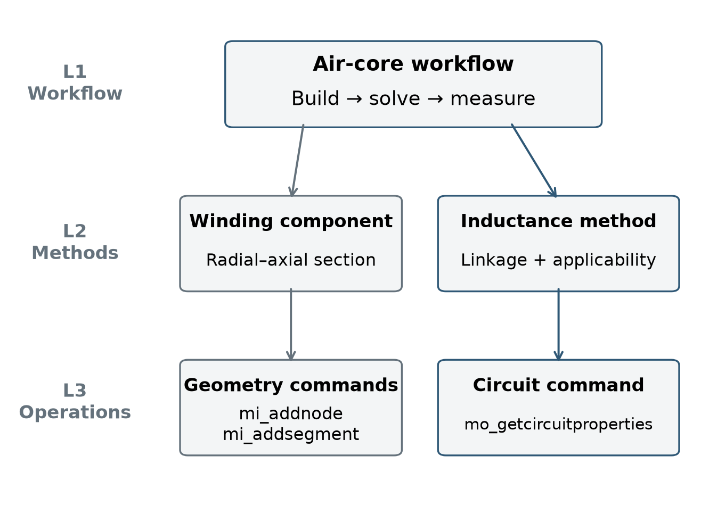
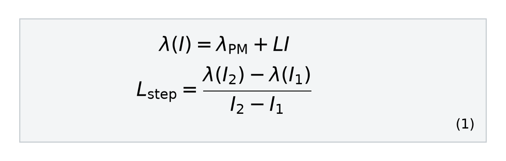
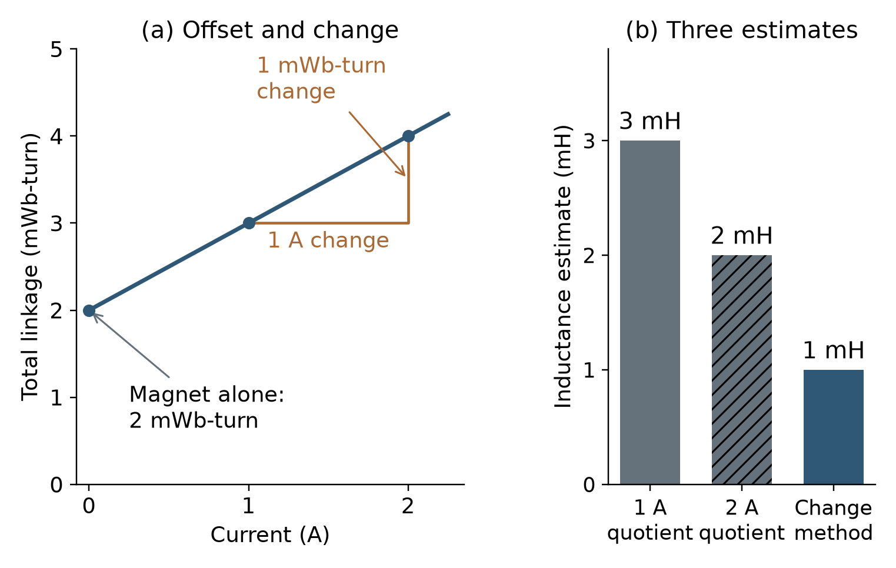

# Part 3: Building a Second Brain for a FEMM Agent

*Follow one measurement method from a stored workflow to its commands, then check when that method stops applying.*

Suppose we return to the project after the coil experiment and ask an agent to calculate winding inductance. The earlier result is available, but the agent also needs to know how it was obtained and when that calculation is appropriate. A number in a report cannot answer those questions on its own.

This is the purpose of the second brain: a persistent engineering notebook that connects a task to a method, the conditions for using it and the evidence behind it. We’ll follow the coil’s inductance measurement through that notebook, then put a permanent magnet beside the winding and see what needs to change.

The general idea of supplying retrieved knowledge to a model is established by work such as [retrieval-augmented generation](https://arxiv.org/abs/2005.11401). [PDE-Agents](https://arxiv.org/abs/2606.07850) connects simulation agents with a knowledge graph. Here the practical question is which records our agent needs to recover a particular FEMM calculation.

## Organize a task at three levels

The notebook separates a workflow, its reusable methods and the solver operations that implement them. Figure 1 labels these as Levels 1, 2 and 3. Follow the inductance branch from top to bottom.



*Figure 1. A selected path through the actual coil records. Level 1 describes the workflow, Level 2 supplies components and measurement methods, and Level 3 identifies FEMM operations. The highlighted branch leads to circuit flux linkage. Sources and numerical evidence attach to the relevant records.*

At **Level 1**, the air-core workflow describes the whole job: construct the section, assign materials and current, define the surrounding air, mesh and solve, then measure the winding. This tells the agent which stages are needed and what each produces.

At **Level 2**, the workflow reuses smaller pieces. The winding component draws the rectangular radial–axial section from Part 1. Its conditions include nonnegative radius and an outer radius larger than the inner radius. A separate method measures inductance from circuit linkage in a linear model with one independent current source.

At **Level 3**, those records point to specific operations. The winding component needs node, segment and material-assignment commands. The inductance method needs `mo_getcircuitproperties`, which returns the circuit’s current, voltage and linkage from a loaded solution. In Python, the binding exposes that operation as `femm.mo_getcircuitproperties`.

Keeping these levels distinct makes a later change easier to locate. Changing a winding dimension uses the same construction method with another input. Changing the meaning of the desired inductance may require another measurement method, even if the drawing stays exactly the same.

## Retrieve the conditions before using the command

The companion contains the project’s graph snapshot. This Python example reads the linear-inductance record and prints its conditions:

```python
import json
from pathlib import Path

brain = json.loads(Path("graph.json").read_text())
records = {node["id"]: node for node in brain["nodes"]}
record = records["method:methods_linear_flux_inductance"]
print(record["constraints"])
```

The record says that permanent-magnet bias or another independently excited winding invalidates the simple linkage/current interpretation for self-inductance. It also requires a stated apparent or incremental definition when saturation matters. These conditions belong beside the method, before the agent reaches for a circuit value.

For the air-core experiment, the conditions fit: the material law is linear, one circuit supplies the excitation, and there is no magnet. Part 2’s native reports provide a numerical check for that particular coil. The notebook keeps the general procedure, its documentation and the tested case separately identifiable.

Now change the physical situation while keeping the measurement command. A permanent magnet can link flux to the winding even at zero winding current. The returned circuit linkage includes that contribution. The command can execute correctly while a later division answers the wrong question.

## What changes when a magnet is present?

A loudspeaker provides a familiar example. Its voice coil sits in the field of a permanent magnet. When the amplifier current changes, the electrical response depends on the extra linkage caused by that change. The magnet’s existing, stationary flux does not become a new current-produced contribution merely because it links the winding.

Use a simple linear illustration to make the distinction visible. Let the magnet contribute a fixed **2 mWb-turn** of linkage. Let each additional ampere in the winding add **1 mWb-turn**. The total linkage is then 2 mWb-turn at zero current, 3 at 1 A and 4 at 2 A. These are chosen teaching values, not new FEMM results.

The notation in Equation (1) separates those contributions. The subscript PM means permanent magnet. The first line is the linear illustration; the second defines a linkage-change estimate using two currents at the same physical position.



*Equation (1). The fixed magnet contribution is λ with the PM subscript; I is winding current. Subtracting the two linkage values cancels that fixed contribution. For a nonlinear winding, the second line gives a finite-step estimate about the chosen current, rather than one universal constant.*

Figure 2(a) shows why the line does not pass through the origin: the magnet supplies linkage before we energize the winding. The small triangle marks the change from 1 to 2 A. Its vertical side is 1 mWb-turn and its horizontal side is 1 A.



*Figure 2. (a) Total linkage in the linear illustration, with the magnet’s fixed offset and a one-ampere change marked explicitly. (b) Dividing total linkage by current gives 3 mH at 1 A and 2 mH at 2 A; using the linkage change gives 1 mH. The bars are calculations from the teaching values, not additional native measurements.*

A linkage change of 1 mWb-turn for a current change of 1 A corresponds to **1 mH**. Turn count is already included in winding linkage. That is the slope we want in this illustration. Dividing the total linkage by current instead includes the magnet offset, so the quotient changes even though the winding’s current-produced response has not changed.

The practical procedure is straightforward in a simulation: hold the magnet and winding still, solve at two currents, and read linkage from each solution. In a physical test, a small current variation at fixed position produces an induced voltage associated with changing linkage. The stationary magnet flux supplies the bias field; it does not add a changing-flux voltage by itself. This is why the incremental response, rather than all the flux already present, matters to the coil’s electrical behavior.

FEMM’s [woofer example](https://www.femm.info/doku/doku.php?id=Woofer) documents this distinction using a magnet-biased voice coil. Its method record is the alternative branch in our notebook. When nonlinear iron is involved, the current step must be checked: the slope can depend on the operating current, and a smaller step may give a different local estimate.

## Save a choice that the next task can inspect

The agent’s decision can now be stated plainly. For the original linear air-core coil, use the linkage/current method. For a magnet-biased winding, inspect the linkage-change method and its position and perturbation requirements. The notebook connects both choices to the operation that reads circuit properties; the difference is in how the returned quantities are used.

The lesson from Part 2 remains useful, with its scope attached: current changed from 1 to 2 A, geometry and turns stayed fixed, and the measured inductance did not change. A report link supplies the evidence. A later task with a magnet should trigger a reconsideration of the measurement, rather than silently inheriting the old formula.

That is the benefit of this hierarchy in practice. It gives the agent a route from a request to a method it can justify, and gives you a record you can inspect when its choice is wrong. In Part 4, we’ll use the same organization for a force calculation, where the selected body becomes part of the measurement.

The [complete examples and recorded results](../examples/part-3/index.html) are available alongside this article.
