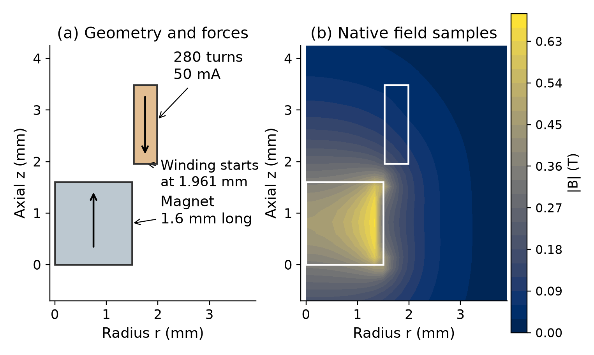
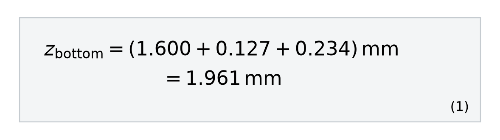
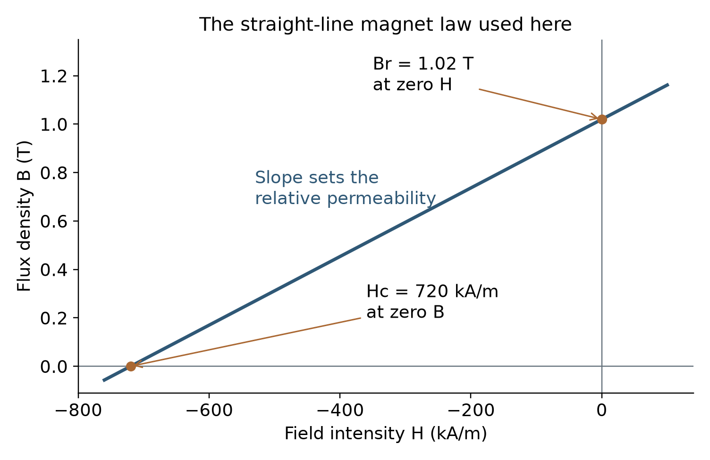
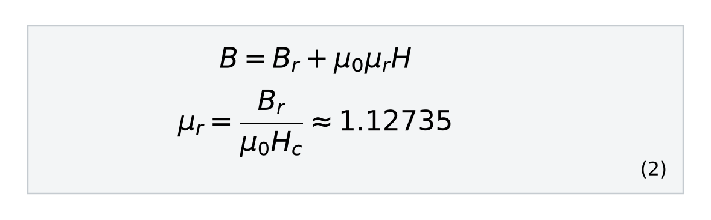
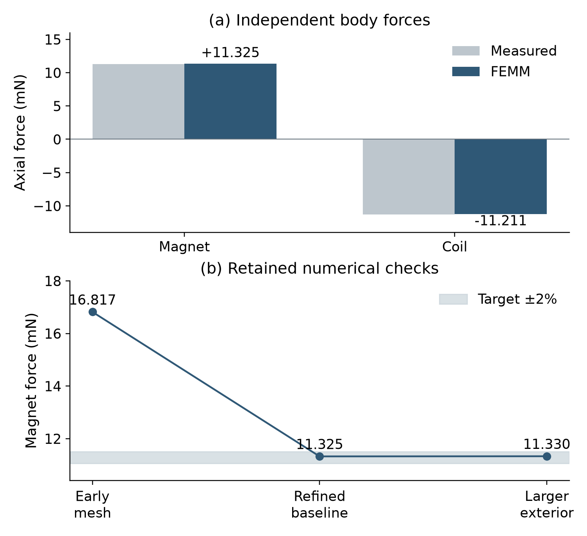

# Part 4: Reproducing a Magnet-and-Coil Force Benchmark in FEMM

*Rebuild a small magnetic device, calculate the force on each part, and investigate an early result that missed the reference.*

A small permanent magnet sits below a circular coil. With current flowing, the magnet is pulled upward and the coil is pulled downward. The forces are only about eleven millinewtons: roughly the weight of 1.15 grams. This is a useful next test for our FEMM workflow because we have a physical device, a measured reference and two forces to calculate independently.

The source is **VM270, Forces in Permanent Magnets**, in the [Ansys Mechanical APDL Verification Manual](https://ansyshelp.ansys.com/public/Views/Secured/corp/v242/en/ans_vm/Hlp_V_VM270.html), based on TEAM Workshop Problem 23. We’ll rebuild its magnet and winding in FEMM, then compare matching force measurements. Figure 1 puts the local geometry beside the solved field.



*Figure 1. (a) The radial–axial section and the expected axial force directions. Revolving the section about the vertical axis produces the circular device. (b) Flux-density magnitude sampled from the unchanged native FEMM model. This is a near-device view; the outer air region extends much farther than the crop.*

Other work already connects agents to finite-element tools, including [FEMM Agent Suite](https://github.com/Zwl20085/femm-agent-suite) and [FEABench](https://research.google/pubs/feabench-evaluating-language-models-on-real-world-physics-reasoning-ability/). Here we’ll concentrate on one reproduction and make the geometry, material choice and force comparison traceable. The second brain from Part 3 supplies a place to keep those choices and their sources.

## Put the winding in the right place

The samarium-cobalt magnet is 2.9972 mm in diameter and 1.6 mm long. The winding has inner and outer diameters of 3.048 and 3.9624 mm, an axial length of 1.524 mm, and 280 turns carrying 50 mA. As in Part 1, an axisymmetric section represents the complete circular winding. Radial coordinates use half the stated diameters.

The first detail to settle is the separation. The source describes a 0.234 mm displacement, but its [input listing](https://ansyshelp.ansys.com/public/Views/Secured/corp/v242/en/ans_vm/Hlp_V_VM270TXT.html) also includes the 0.127 mm end of the winding form. With the magnet’s lower face at the coordinate origin, the winding’s lower edge follows Equation (1).



*Equation (1). Add the magnet length, form-end thickness and specified displacement. The winding begins at 1.961 mm and ends at 3.485 mm along the axis.*

Placing the winding only 0.234 mm above the magnet would create another geometry. A solver could calculate that geometry perfectly and still disagree with this experiment. Reading the coordinate construction first prevents us from treating a source-interpretation error as a numerical error.

The brass form is treated as nonmagnetic here. Its thickness locates the winding, while its magnetic material response can be represented by the same unit relative permeability as the surrounding air.

## Describe the magnet before assigning its material

Unlike the air-core coil, this device has a field source even when winding current is zero. The magnet needs a direction of magnetization and a material law. For this case the direction is upward along the axis. The material law is the straight line shown in Figure 2.



*Figure 2. The source’s linear magnet representation. Remanence Br is the B-axis intercept at zero applied H. The opposing-field intercept has magnitude Hc. Relative permeability describes the line’s slope after accounting for the permeability of free space. This is a material-law sketch, not a spatial field plot or a complete hysteresis loop.*

**Remanence**, Br, is **1.02 T**: the flux density at zero applied field intensity in this representation. It does not mean that every point in the assembled device must have a field of 1.02 T. The magnet’s shape and surrounding magnetic path also affect the resulting field.

The **coercive field parameter**, Hc, is **720,000 A/m**. In this straight-line model, an opposing field of that magnitude brings B to zero. The **relative permeability**, μr, sets how steeply B changes with H. The source defines it from the two intercepts, as in Equation (2), giving approximately **1.12735**.



*Equation (2). H is field intensity, B is flux density and μ₀ is the permeability of free space. The reconstruction follows the permeability expression in the input listing; the overview’s printed numerical value is slightly different.*

With a magnetic document open, the material assignment can be expressed in Python as:

```python
import math
mu0 = 4e-7 * math.pi
Br, Hc = 1.02, 720_000
mu_r = Br / (mu0 * Hc)
femm.mi_addmaterial("SmCo", mu_r, mu_r, Hc, 0, 0)
```

The magnet region receives that material and its upward magnetization direction. The winding receives a 50 mA circuit assignment and 280 turns. Those assignments make the drawn regions active magnetic sources.

The notebook organizes this as the geometry, material-and-current, exterior-and-mesh, and force-measurement stages. Each stage points to the relevant reusable methods and FEMM operations. For this reproduction, the source dimensions and material law determine their inputs; the desired force determines the postprocessing selection.

## Calculate one force for each body

Before comparing numbers, we need to decide what each force means. For the copper winding, we integrate the Lorentz force density through its volume. Current density J and the local field B enter Equation (3); FEMM accounts for the volume represented by the axisymmetric section.


*Equation (3). The reported coil result is the axial component of this volume integral. A field sample at one point is not a replacement for the integral.*

For the magnet, we use a weighted-stress force calculation. The magnetic field in the surrounding air transmits stress to the body; FEMM uses that field to evaluate the net force on the selected magnet. This gives a different numerical measurement from the winding’s current-density integral.

With the solution loaded, the Python extraction selects a point inside the magnet, evaluates its axial weighted-stress force and clears the selection:

```python
femm.mo_selectblock(0.7493, 0.8)
magnet_force_N = femm.mo_blockintegral(19)
femm.mo_clearblock()
```

The point selects the whole region. It is not a point at which force is sampled. For the coil, we select its interior and use integral type 12 for the axial Lorentz force. Type 19 is also applied to the coil as a second estimate. The companion keeps the complete model and extraction steps together.

We calculate both body forces, rather than assigning one as the negative of the other. Their balance then becomes a useful check on the numerical result.

## Check the result—and the run that did not agree

The measured target in the source input is **+11.2815 mN** for the magnet and **−11.2815 mN** for the coil. We chose a **2%** relative comparison band before solving. The retained FEMM baseline gives **+11.3247 mN** and **−11.2106 mN**, corresponding to absolute relative errors of **0.383%** and **0.628%**. Both pass. The unchanged model was replayed for this revision and reproduces those results.



*Figure 3. (a) Measured and native body forces, keeping their signs. (b) The retained early trial, refined baseline and larger-exterior control for the magnet. The shaded band is the measured target ±2%; it is our comparison criterion, not a stated uncertainty of the experiment.*

An early run had looked encouraging if we checked only the winding: its force was about **−11.1848 mN**. The magnet’s force, however, was **+16.8174 mN**, roughly **49% high**. Measuring both bodies exposed the problem.

The refined baseline uses fine air regions around the magnet and winding. These are mesh-control regions, all with the same air material law; they are not extra physical shells. Resolving that nearby field matters because the magnet’s stress-based force depends on it. The final coil stress estimate is **−11.2149 mN**, close to its Lorentz result, while the residual imbalance between magnet and coil forces is about **0.1141 mN**.

We also enlarged the exterior radius from **20 to 40 mm**, keeping the prescribed physical mesh lengths fixed. The magnet force changed from **11.3247 to 11.3298 mN**, about **0.0457% of the measured reference**. That is evidence for this exterior-size check, rather than a general convergence proof. The larger domain also changes the resulting mesh.

This gives us a complete, limited result: the chosen device and operating point reproduce the measured forces within the frozen criterion, and the retained failed trial shows why checking one convenient output was insufficient. The source inputs, complete scripts and reports remain in the companion files. Part 5 takes the same process to a motor paper, where the physical inputs themselves require more interpretation.

The [complete examples and recorded results](../examples/part-4/index.html) are available alongside this article.
